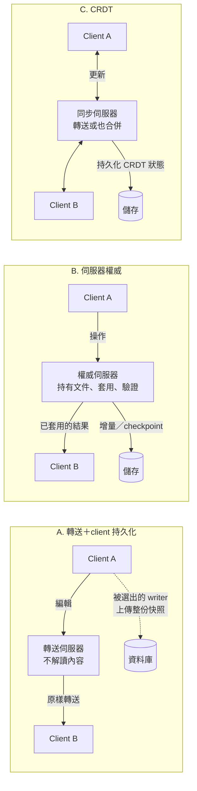
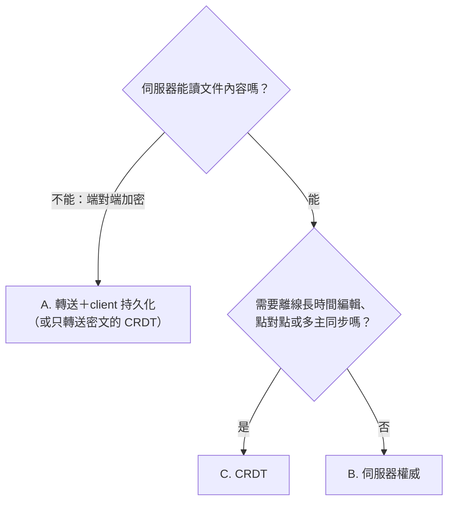

# 共編的權威拓撲：轉送＋client 持久化、伺服器權威與 CRDT

> **Pattern 一句話**：共編架構的第一個決定是「誰持有文件的真相」。伺服器看不到內容（端對端加密）
> 時只能讓伺服器轉送、由 client 持久化；伺服器看得到內容時，讓伺服器成為權威通常更簡單、更可靠，
> 持久化延遲與加入速度也更好——代價是伺服器 CPU、記憶體與合併邏輯搬到伺服器端。前提一變，
> 拓撲就該重新評估，而不是在舊拓撲上繼續補洞。

## 問題

多人同時編輯同一份文件，系統必須回答四件事：

1. **即時同步**：A 的編輯怎麼最快出現在 B 的畫面上；
2. **合併**：A、B 同時改同一個東西時誰贏、怎麼收斂；
3. **持久化**：什麼時候算「已保存」、由誰寫進資料庫；
4. **加入與恢復**：新成員或斷線重連的人從哪裡拿到完整的最新狀態。

這四件事由誰負責，決定了整個系統的複雜度落在哪一端。常見的錯誤是只看第 1 點（大家都能做到
低延遲轉送），忽略持久化與恢復的責任在哪裡——那才是長期維護成本與故障模式的來源。

## Pattern

### 三種拓撲

|                    | A. 轉送＋client 持久化         | B. 伺服器權威                               | C. CRDT                              |
| ------------------ | ------------------------------ | ------------------------------------------- | ------------------------------------ |
| 文件真相           | 每個 client 各一份，靠快照收斂 | 伺服器那一份                                | 數學上保證收斂的資料結構，每份都等價 |
| 合併在哪裡         | client（各自 reconcile）       | 伺服器（client 樂觀套用後以伺服器結果為準） | 任何一端都可以，結果相同             |
| 誰寫資料庫         | 一個被選出的 client            | 伺服器                                      | 伺服器（或任一端）                   |
| 伺服器要看懂內容嗎 | 不用（可端對端加密）           | 要                                          | 合併在伺服器時要；只轉送時不用       |
| 典型例子           | excalidraw.com（端對端加密）   | Figma、Google Docs、tldraw sync             | Yjs、Automerge、Liveblocks 一類      |

### 選擇的主要驅動：伺服器能不能讀內容

端對端加密把選項幾乎鎖死在 A：伺服器看不到內容，就只能轉送，持久化只能交給 client。
一旦內容對伺服器可讀，B 通常是預設選擇；C 適合離線優先或去中心化的場景，代價是資料結構與
儲存成長（tombstone、歷史）的額外複雜度。

### A 拓撲必須額外承擔的機制

伺服器不持有狀態，所以「持久化」與「恢復」都要在 client 端重建：

- **writer 選舉**：避免 N 個 client 各寫一次（見 [client 寫入節奏與 writer 選舉](client-write-pacing-and-writer-election.md)）；
- **存檔週期與請求轉交**：非 writer 的保存要求要送給 writer，並設逾時；
- **結果未知的恢復**：上傳回應遺失時，要 query 或重新讀取 durable 快照才能確認；
- **加入基準**：新成員要從資料庫或其他 client 拿完整快照，並在拿到前擋住編輯；
- **離開時的強制寫入**：最後一人離開時，他的瀏覽器是唯一副本。

這些機制都可以做對，但每一個都是新的故障面。最典型的一個：**持久化依賴「某個 client 還活著
且被選中」**。死掉但還沒被移除的連線當選 writer 時，保存會停到它被移除為止。

## 效能比較：伺服器權威長期是否比較好？

結論：**在內容可讀的前提下，伺服器權威在持久化延遲、加入速度、頻寬與可靠性上都較好；即時
轉送延遲大致相同；代價集中在伺服器端的 CPU、記憶體與實作複雜度。**逐項比較：

| 面向               | A. 轉送＋client 持久化                                  | B. 伺服器權威                                              | 誰較好                               |
| ------------------ | ------------------------------------------------------- | ---------------------------------------------------------- | ------------------------------------ |
| 即時同步延遲       | 一跳轉送                                                | 一跳轉送（可先轉送、後持久化）                             | 相同                                 |
| 「已保存」延遲     | client 編碼整份文件 → 上傳 → 經多層服務 → 資料庫 → 回覆 | 伺服器把操作寫進本地儲存即可回覆，資料庫 checkpoint 在背景 | **B 明顯較好**                       |
| 加入／重連         | 從資料庫讀快照，或等其他 client 提供                    | 伺服器直接從記憶體或本地儲存送出現況                       | **B 較好**                           |
| client 上行頻寬    | writer 週期性上傳整份文件（與文件大小成正比）           | 只送操作                                                   | **B 較好**，大文件與行動網路差距更大 |
| 伺服器 CPU／記憶體 | 幾乎不解讀內容                                          | 要解析、驗證、套用操作並持有文件                           | **A 較省**                           |
| 單房間上限         | 轉送吞吐                                                | 單一權威實例的 CPU 與記憶體                                | A 稍高；一般白板規模兩者都夠         |
| 持久化可靠性       | 依賴被選中的 client 存活                                | 只依賴伺服器                                               | **B 較好**                           |
| 一致性             | 各 client reconcile，靠快照收斂                         | 單一真相                                                   | **B 較簡單**                         |

幾個常見誤解：

- **「伺服器權威要一直醒著，所以很貴」不成立。** 在 A 拓撲裡，每一則編輯本來就要喚醒轉送
  伺服器；B 只是醒著時多做套用與寫入。可休眠的平台（例如按 wall-time 計費的 actor）上，B 一樣
  可以把文件存進 actor 的本地儲存、閒置時休眠，醒來時從本地儲存載入。
- **「轉送比較快」只對即時同步成立。** 使用者感受到的另一半——保存與加入——在 A 拓撲裡要走
  完整的上傳與資料庫往返，這通常才是延遲大頭。
- **伺服器權威不會自動解決所有延遲。** 圖片、附件等大型二進位檔通常走物件儲存，與文件拓撲
  無關；如果它們是瓶頸，要另外處理儲存位置與上傳流程。

## 評估

這篇最值得帶走的一句：**拓撲是由「伺服器能不能讀內容」這個前提決定的；前提改變時，原本合理
的拓撲可能變成負債。** A 拓撲在端對端加密下是正確、甚至唯一的選擇；同一套設計在內容改為
伺服器可讀之後，留下的是一整套在 client 端重建持久化的機制，以及只有伺服器權威才能根除的
故障模式。

判斷一個共編設計好不好，與其問「延遲多少」，不如問：**持久化與恢復的責任在誰身上，以及那個
角色會不會不見。** 伺服器不會因為使用者闔上筆電而消失，client 會。

## Trade-offs

- **遷移成本高**：從 A 換到 B 需要新的協定版本、把合併邏輯搬到伺服器、資料遷移與完整重新驗收；
  規模不大、只有少量使用者時，A 的已知限制可能比遷移風險便宜。
- **合併邏輯必須在兩端一致**：B 的 client 仍會樂觀套用自己的編輯，再以伺服器結果為準；兩端的
  套用規則若不同，會出現跳動或還原。最好讓兩端共用同一份合併程式碼。
- **伺服器資源**：B 的單一權威實例要持有文件並做 CPU 工作；超大文件或極多人房間要另外切分。
- **端對端加密不相容**：B 需要伺服器讀內容。若日後要恢復加密，只能回到 A 或只轉送密文的 CRDT。
- **不適用的情況**：需要長時間離線編輯、點對點同步或多主複製時，C 比 B 合適。

## 本專案中的實例

- **現況是 A 拓撲**：Durable Object 只轉送房間訊息，畫布快照由可編輯者中 peerId 最小的 client
  寫入（[即時協作房間](realtime-room-coordination.md)、[client 寫入節奏與 writer 選舉](client-write-pacing-and-writer-election.md)）。
  這是加密房間時代的設計；plan 21（2026-10-10）把房間改成明文、只保留分享連結的端對端加密，
  選擇 A 的主要理由因此消失。
- **已觀察到的 A 拓撲故障模式**：沒有 close frame 就斷掉的連線要等 lazy liveness 判定才移除，
  它當選 writer 時耐久保存會停頓。正式驗收的證據、評估過的處理方式與「維持現狀」的決定見
  [18D 結案](../deployment/collaboration-reset/README.md#18d-結案2026-10-12)。
- **實測延遲的構成**：保存與加入的大頭是附件上傳、callback 與下載的跨雲往返，快照寫入本身較小
  （[P0 測量契約的驗證紀錄](../performance/collaboration-storage-p0.md)）。改成伺服器權威能縮短快照
  保存與加入基準的部分；附件延遲要另外靠儲存位置處理。
- **可休眠 actor 的成本模型**見 [成本感知的有狀態服務](cost-aware-stateful-services.md)：伺服器權威
  可以沿用「閒置休眠、狀態存在 actor 本地儲存」的做法，不需要常駐。
